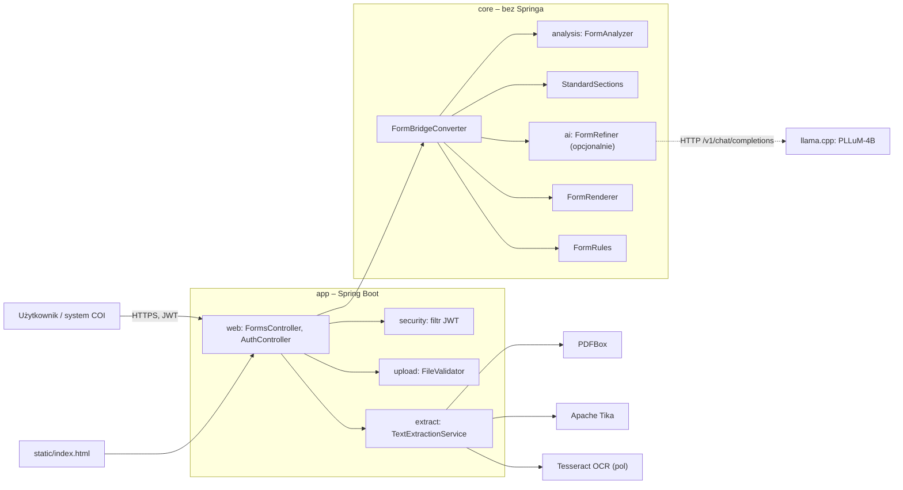
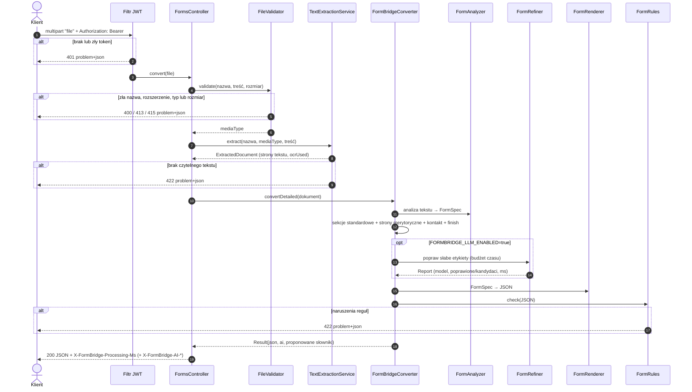
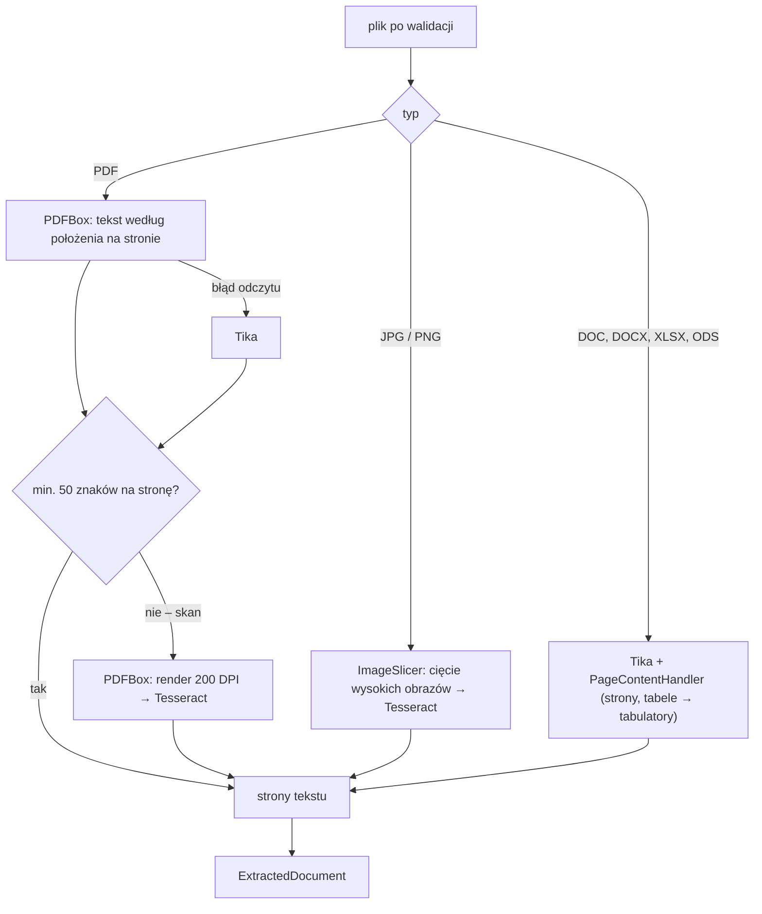
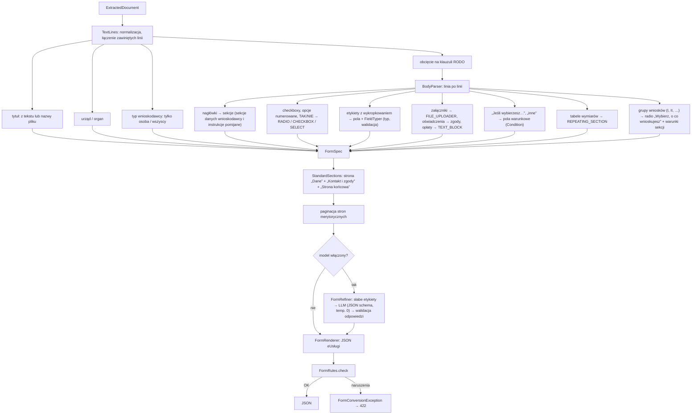
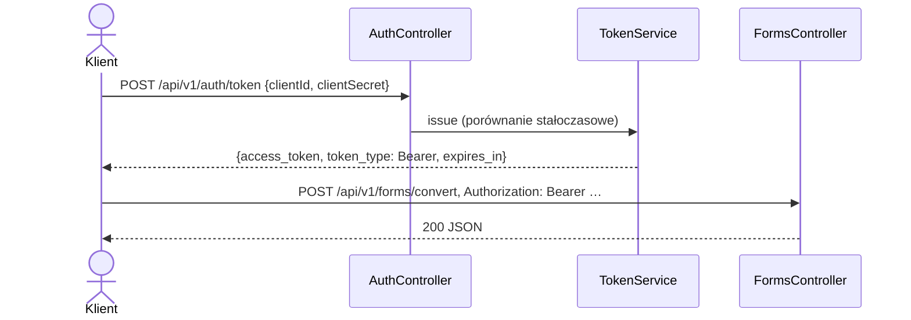
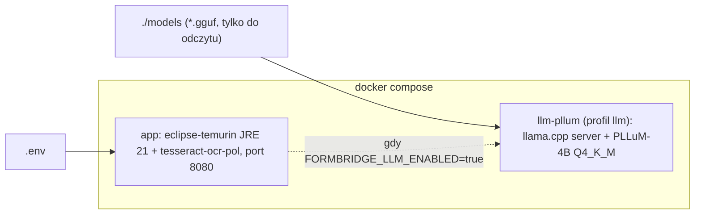

# FormBridge – architektura i przepływ

FormBridge zamienia wniosek (PDF, DOC/DOCX, XLSX/ODS, JPG/PNG) na plik JSON
w formacie importu eUsługi (`importowanyPlikJsonSchemat`). Cała aplikacja działa
lokalnie, bez GPU i bez usług chmurowych.

Główna zasada: ok. 85% typowego e-formularza to sekcje standardowe umieszczone
w dostarczonych plikach (urząd, dane wnioskodawcy, adresy, pełnomocnictwo, kontakt,
zgody, strona końcowa). Aplikacja generuje je deterministycznie z szablonów.
Z treści wniosku rozpoznajemy regułami tylko część merytoryczną. Model
językowy jest opcjonalny i poprawia wyłącznie słabe etykiety.

## 1. Gdzie co jest

```
src/main/java/pl/formbridge/
├── core/                      rdzeń: tekst → JSON (bez Springa)
│   ├── FormBridgeConverter    punkt wejścia: convert / convertDetailed
│   ├── ExtractedDocument      wejście: nazwa pliku, typ, strony tekstu, czy był OCR
│   ├── StandardSections       sekcje standardowe (dane, adresy, pełnomocnictwo, kontakt, finish)
│   ├── StandardTexts          teksty HTML sekcji standardowych (resources/core/standard-texts.json)
│   ├── FormRenderer           FormSpec → JSON: siatka x/y/rows/cols, UUID, flow, kolejność kluczy
│   ├── FormRules              kontrola zgodności z Regułami technicznymi
│   ├── TechNames              nazwy techniczne snake_case, unikalność
│   ├── analysis/
│   │   ├── TextLines          normalizacja linii, wykropkowania, znaki checkboxów
│   │   ├── FieldTyper         typ pola i walidatory (PESEL, NIP, REGON, e-mail, kod…)
│   │   └── FormAnalyzer       tytuł, urząd/organ, typ wnioskodawcy, sekcje, pola, warunki
│   ├── model/                 FormSpec → PageSpec → SectionSpec → FieldSpec, Condition (JSONata)
│   └── ai/                    opcjonalnie: LlmClient, LlamaCppClient, FormRefiner
└── app/                       aplikacja Spring Boot
    ├── FormBridgeApplication
    ├── config/                FormBridgeProperties (formbridge.*), ConverterConfig (bean konwertera)
    ├── upload/FileValidator   rozszerzenie, typ MIME z treści, nazwa pliku, rozmiar
    ├── extract/               TextExtractionService, PdfToText, TesseractOcr, ImageSlicer, PageContentHandler
    ├── security/              JWT HS256: SecurityConfig, TokenService, JwtSupport
    └── web/                   FormsController, AuthController, błędy RFC 7807

src/main/resources/
├── application.yml            konfiguracja (wszystko ze zmiennych środowiskowych)
├── core/standard-texts.json   teksty sekcji standardowych
└── static/index.html          strona do konwersji i podglądu e-formularza

src/test/                      testy core (9 wniosków z wyzwania) i app (API, walidacja, JWT, ekstrakcja)
scripts/                       pobranie modeli, test modelu, generowanie wyników dla katalogu PDF
Dockerfile, docker-compose.yml obraz aplikacji (z Tesseractem), opcjonalne serwery modeli
```

## 2. Komponenty



`core` nie zależy od `app`. Kontrakt między nimi to jedno wywołanie:

```java
new FormBridgeConverter().convert(new ExtractedDocument(fileName, mediaType, pages, ocrUsed));
```

## 3. Przepływ żądania `POST /api/v1/forms/convert`



`POST /api/v1/forms/convert-batch` (pole `files`, domyślnie do 20 plików)
przetwarza każdy plik tak samo. Zwraca tablicę wyników: dla każdego pliku
`status`, `processingMs` i `form` albo `error` w formacie RFC 7807. Błąd
jednego pliku nie przerywa pozostałych.

## 4. Ekstrakcja tekstu



Dlaczego PDF czytamy wprost przez PDFBox, a nie przez Tikę: Tika inaczej składa
linie formularzy z tabelami, co na wnioskach z wyzwania dawało błędne pola.
PDFBox z sortowaniem według położenia daje układ, na którym są testowane reguły
(`src/test/resources/forms`). Linie z kilkoma kolumnami, opcjami z kratkami
w jednym wierszu („Płeć: ❑ pies ❑ suka”) albo kolejnymi numerami pozycji
(„8. Kraj 9. Województwo”) rozdziela `TextLines.normalize`.

## 5. Analiza i budowa formularza (core)



Najważniejsze reguły wyniku, zgodne ze wzorcami COI:

- na najwyższym poziomie strony jest tylko `SECTION` / `REPEATING_SECTION` (`x=0`, `cols=3`, `rows` = liczba pól + 1, `questionOrder` = `y`), pola są w `repeatingSectionGrid`;
- strony `MAIN` i dokładnie jedna `FINISH` na końcu, na której nie ma pól do wypełnienia;
- opcje mają `id = name =` etykietę i `techName` w snake_case;
- dane z profilu (`MLPZ.name`, `MLPZ.surname`, `MLPZ.pesel`…) są wypełniane z `EXTERNAL_SYSTEM`;
- warunki widoczności to wyrażenia JSONata w formacie wzorców, np.
  `("X" in tabs['Tab' in title].questions['sekcja' in field.techName].field.repeatingSectionGrid['pole' in field.techName].field.__userAnswer)`;
- identyfikatory to UUID v3 z `tytuł|ścieżka`, więc ten sam plik daje zawsze ten sam JSON.

`FormRules` sprawdza: liczbę stron i stronę FINISH, umieszczenie pól
w sekcjach, brak zagnieżdżonych sekcji, unikalne ID i nazwy techniczne, słowniki
tylko w polach wyboru, opcje w polach wyboru oraz kompletność `flow`.

## 6. Bezpieczeństwo



- JWT HS256: sekret tylko ze zmiennej `FORMBRIDGE_JWT_SECRET`, czas życia `FORMBRIDGE_JWT_TTL` (domyślnie 1 h).
- Publiczne są: strona, `/api/v1/auth/token` i `/actuator/health`. `/api/v1/forms/**` wymaga tokenu.
- `FORMBRIDGE_SECURITY_ENABLED=false` wyłącza uwierzytelnianie, np. do lokalnego pokazu.
- Walidacja pliku: rozszerzenie bez rozróżniania wielkości liter, typ MIME rozpoznany z treści (Tika) zgodny z rozszerzeniem, nazwa do 250 znaków bez `; : > < / \ | ' * % $`, limit rozmiaru.
- Błędy w formacie `application/problem+json` (RFC 7807), bez śladów stosu.
- Kontener: użytkownik bez uprawnień root, `read_only`, `tmpfs /tmp`, `no-new-privileges`.

## 7. Uruchomienie (wdrożenie)



| Polecenie | Co uruchamia |
|---|---|
| `docker compose up --build` | sama aplikacja, bez modelu (domyślnie) |
| `docker compose --profile llm up --build` | aplikacja i PLLuM; dodatkowo `FORMBRIDGE_LLM_ENABLED=true` w `.env` |
| `bash scripts/download-models.sh` | pobranie modeli do `models/` |
| `bash scripts/generate-outputs.sh <katalog> [api]` | konwersja wszystkich plików z katalogu do `output/` |
| `bash scripts/llm-smoke.sh` | test szybkości i jakości serwera modelu |
| `mvn test` | testy core i app |

Model jest domyślnie wyłączony. Na laptopie bez GPU PLLuM-4B generuje
ok. 4–5 tokenów na sekundę i w testach nie poprawiał etykiet, a wydłużał
konwersję do 20–50 s. Bez modelu konwersja trwa poniżej sekundy.

## 8. Najważniejsze decyzje

| Decyzja | Powód                                                                                    |
|---|------------------------------------------------------------------------------------------|
| Reguły i szablony zamiast generowania całego JSON przez LLM | powtarzalność, zgodność ze standardami, działanie bez GPU i chmury, czas poniżej sekundy |
| Model językowy tylko jako opcja dla słabych etykiet | po pomiarach na zwykłym laptopie: wolny i bez poprawy jakości                            |
| `core` bez Springa | łatwe testy i możliwość osadzenia w innym systemie                                       |
| Deterministyczne UUID v3 | ten sam wniosek daje ten sam wynik, a różnice w Git są czytelne                          |
| `FormRules` przed zwróceniem wyniku | lepiej zwrócić 422 z opisem niż JSON, którego eUsługa nie przyjmie                       |
| PDFBox zamiast Tiki dla PDF | układ linii, na którym reguły są przetestowane; licencja Apache 2.0 |

## 9. Ograniczenia

- Deklaracja odpadowa (formularz 8) z gęstą numerowaną tabelą wymaga jeszcze ręcznych poprawek.
- Nazwa urzędu, gdy nie występuje w treści, zostaje polem do wypełnienia.
- Zeskanowane wnioski zależą od jakości OCR.
